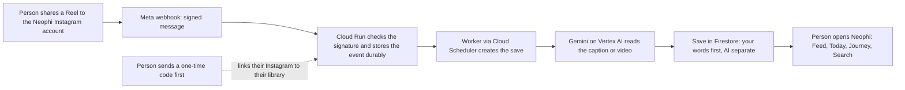
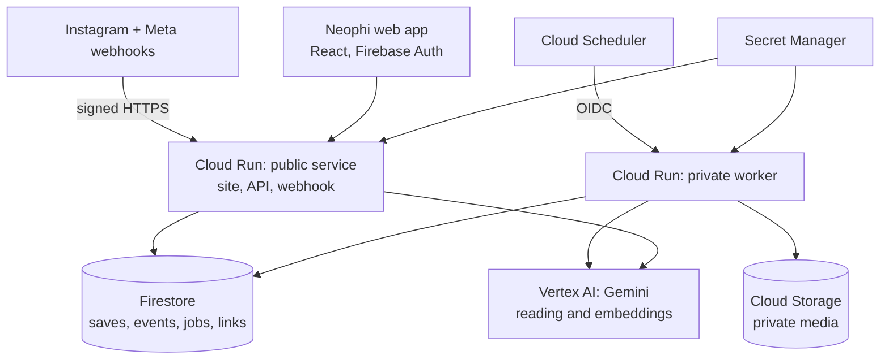

# Pitch deck content, slide by slide

Follows the organiser's template sections in order (one slide each unless noted). Build it in the template (File > Download > .pptx, fill, export PDF, up to 10 MB). Items in [square brackets] must be confirmed by the team before export. Numbers marked (measured) come from our own tests and runs; do not round them up.

---

## 1. Team name / Team size
- **Team name:** [confirm]
- **Team size:** [confirm: 2]
- **Product:** Neophi. *Saving is a decision. Neophi keeps it.*
- **Live prototype:** https://neophi-4ngyvfbl6a-el.a.run.app (open it, tap **Open Neophi**).

## 2. Problem statement
Everyone saves Reels and posts on Instagram, and it happens to all of us. When you save one, your brain makes a decision for your future self: a plan, an idea, inspiration, something to study, a piece of advice, anything. Almost always that decision is gone later, and the saving effort was wasted. For three reasons:
1. **You forget to open it again.** The save sits there and nothing brings you back to it.
2. **When you do go, it is a grid of thumbnails.** You made collections, but a collection is only thumbnails; it gives you nothing to act on. What you saved a week ago, and anything older, is effectively lost.
3. **Even when you find the Reel and open it, you no longer remember why you saved it, or what in it mattered.**

## 3. Brief about the idea
Neophi helps you take charge, so your decision gets its value back. Send a Reel or post to Neophi on Instagram, like you would send it to a friend, and say why if you like (the message is optional). Neophi keeps your words exactly as typed, reads the save with Gemini on Vertex AI (what it is, the key points, and any next steps, right then and there), and brings everything together in **Journey**, one tree of smart groups that grows by itself. You get what you saved, you remember it, and you know what to do next.

## 4. Opportunities
**How different is it from other ideas?**
- Instagram's Saved tab and collections store the *post* as a thumbnail. Neophi stores the *decision*: your own words, first, always, plus what mattered and the next steps.
- Notes apps need you to leave Instagram and write. Neophi works from the share you already do.
- AI summarisers describe content and guess. Neophi never invents why you saved it; AI text is labelled, separate, shows its evidence or says it is not sure; and it uses a caption only when the caption is genuinely about the Reel (copy-pasted text, hashtag walls and other-language dumps are ignored and said so).

**How will it solve the problem?**
It answers the three reasons directly: it brings saves back (Today, search, reminders), it replaces the wall of thumbnails with **Journey** and the key points of each save, and it keeps the reason and what mattered so you remember why you saved it, with next steps given there and then.

**USP**
1. Your words first, exactly as typed. 2. The AI is kept apart and honest (labelled, evidence, "not sure", ignores caption noise). 3. **Journey**: everything in one growing tree instead of thumbnails and folders. 4. Works from the Instagram share you already do; no new habit; works even without a note. 5. Private by design. 6. Built to be multiplatform: one Google account, many connections (Instagram today, more coming).

## 5. List of features offered
- Share a Reel or post to the Neophi Instagram account by DM; optional words with it.
- One-time code connect from the website (about 10 seconds), disconnect in one tap.
- Your exact words kept and shown first; AI reading separate, labelled, with evidence.
- Journey: tree of smart groups (branches, topics, saves), by theme or by time, search, new growth marked.
- Feed, Today (what to come back to), Projects (trip or content brief drafts with sources), search in Hindi, Hinglish and English.
- Reminders and calendar export; save from a link, upload or screenshot too.
- Private saves (no AI), export everything, delete everything.
- Try without Instagram: a clearly labelled simulated share for reviewers.

## 6. Process flow diagram

## 7. Wireframes / mock diagrams
Use screenshots from docs/screens at phone width: (1) Connect sheet with the code, (2) Feed card with the person's words first, (3) Journey tree, (4) Save page with the four sections (source, your words, your choices, AI ideas).

## 8. Architecture diagram

## 9. Technologies to be used
**Google AI tools used to build it:** Google Antigravity, Google AI Studio, Gemini CLI, Google's Firebase, Cloud Run and gcloud tool servers, and Gemini Veo 3.1 (the video on the website's main page).

Google Cloud: Cloud Run (public service and private worker), Firestore (with vector index), Cloud Storage, Cloud Scheduler, Secret Manager, Firebase Authentication, Vertex AI with Gemini (reading, search understanding, embeddings). Meta Instagram messaging webhooks. React, TypeScript, Vite, Node and Express.

## 10. Estimated implementation cost (optional)
About 0.5 US cent per analysed save on the Gemini model we use (measured on a 12-item test: about 1,283 input and 1,140 output tokens on average; re-check current Vertex prices before quoting). 300 saves a month is about $1.57 at that rate. Cloud Run, Firestore and Storage are at pay-as-you-go prototype scale. Free tier of a few dozen analysed saves a month is affordable.

## 11. Snapshots of the prototype
Same screens as slide 7 plus: Try without Instagram, Settings (export and delete everything), Hinglish search.

## 12. Prototype performance report / benchmarking
Fill from docs/BENCHMARKS.md (measured, counts only):
- Whole journey on Cloud Run: **18 of 18** checks pass (connect with a code, Reel and note, save, reading, cleanup).
- Deployed-service acceptance checks: **10 of 10**.
- Automated tests: [number from the latest `npm test`] passed.
- Share to save: [seconds from the journey check]; note kept byte for byte.
- Reading quality on a small synthetic set across Reel types (before to after the type-aware reading): valid outputs [..], type accuracy [..], evidence cited [..]. State plainly: small test, not a benchmark.
- Live test with a real Instagram account: 3 links, 8 shares, 8 notes, 0 failed jobs, 0 rejected signatures, 0 server errors.

## 13. Additional details / future development
- **Check this Reel:** send a Reel only to check it; Neophi replies in the same chat with a short plain verdict (what holds up, what does not, what could not be checked, with sources). Says "could not verify" rather than guess; never accuses a person. Needs Meta's messaging permission and a search-grounded check.
- **Affiliate income** for saves that are products, books, tools or places, shown apart from the person's words and the AI's reading.
- **Plans:** free analysed saves each month, a personal plan, a creator plan, teams later.
- **Install and share from the phone**, reminders, keep your library across browsers with a Google sign-in.
- **Honest limits today:** Instagram connection runs in Meta's development mode (approved testers); a shared Reel gives link and caption, not video; tests so far are small.
